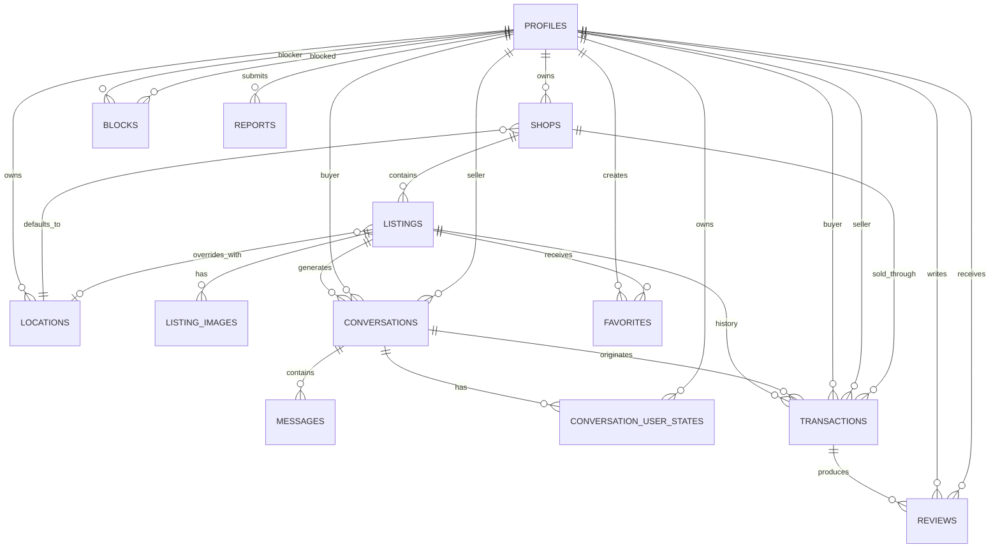

# Marketplace ER Model v1

## Core entities

- `profiles`
- `locations`
- `shops`
- `listings`
- `listing_images`
- `conversations`
- `conversation_user_states`
- `messages`
- `transactions`
- `reviews`
- `favorites`
- `blocks`
- `reports`

## Entity relationship diagram



## Cardinalities

### Profiles and Shops

```text
Profile 1 ─── * Shops
```

Initial business rule: one included Shop.

Database relationship intentionally supports multiple Shops.

### Shops and Listings

```text
Shop 1 ─── * Listings
```

Every Listing belongs to exactly one Shop.

### Profiles and Locations

```text
Profile 1 ─── * Locations
```

Locations are owned by Users because exact location data is sensitive.

### Shops and Locations

A Shop has a default Location.

The relationship should ensure the Location belongs to the same User who owns the Shop.

### Listings and Locations

A Listing may have zero or one location override.

Effective location is:

```text
Listing override
or
Shop default
```

### Listings and Conversations

```text
Listing 1 ─── * Conversations
```

Each Conversation concerns exactly one Listing.

A buyer/listing pair should normally be unique.

### Conversations and Messages

```text
Conversation 1 ─── * Messages
```

### Conversations and per-user state

Archiving/hiding is per participant, not global.

```text
Conversation 1 ─── * ConversationUserStates
Profile 1 ─── * ConversationUserStates
```

### Listings and Transactions

```text
Listing 1 ─── * Transactions
```

Cancelled Transactions remain historical records.

Only one active Transaction may exist per Listing at a time.

### Transactions and Reviews

```text
Transaction 1 ─── 0..2 Reviews
```

Maximum:

- one buyer → seller Review;
- one seller → buyer Review.

### Profiles and Favorites

Many-to-many through `favorites`.

### Profiles and Blocks

Directed User-to-User relationship through `blocks`.

### Reports

A Report belongs to one reporter and targets exactly one reportable entity.

## Important structural decisions

### Supabase Auth

`auth.users` owns authentication.

`public.profiles` is the marketplace/domain User.

Relationship:

```text
auth.users 1 ─── 1 profiles
```

### Exact locations

Exact addresses/coordinates should not live directly on public Shop rows.

Use protected `locations` records.

### Conversation archiving

Do not model `ARCHIVED` as a global Conversation lifecycle state.

Use per-user state instead.

### Reservation

Do not create a `reservations` table.

Reservation is the starting state of a Transaction.

### Offers

Do not create an `offers` table in v1.

Negotiation remains free-form inside Conversation messages.
